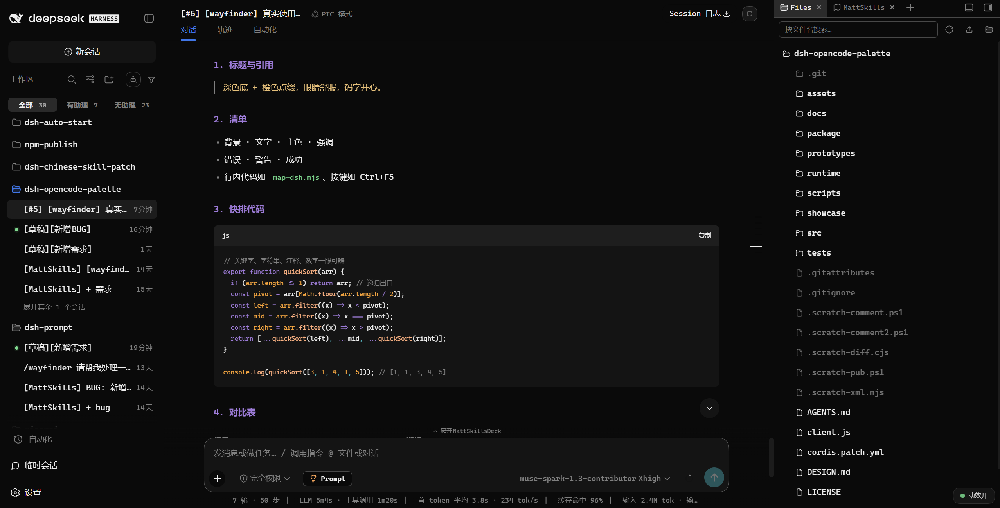
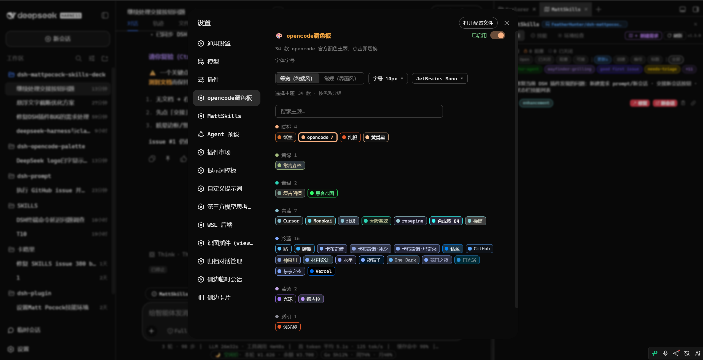
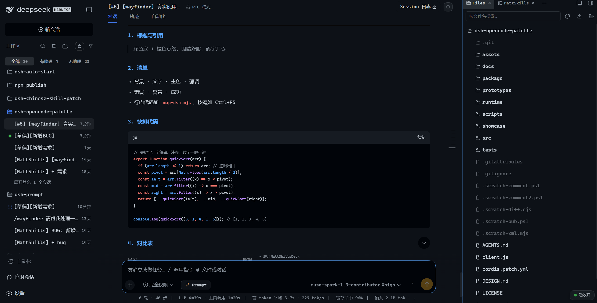
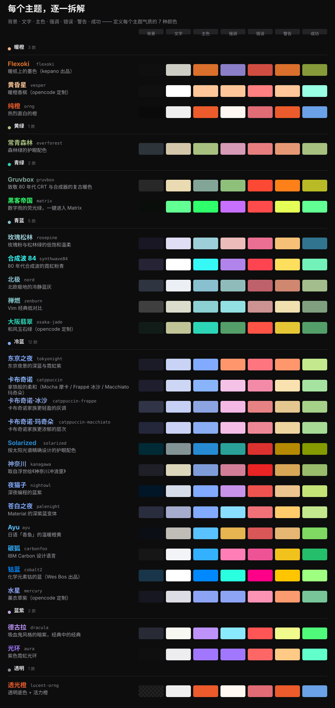

<h1 align="center">🎨 dsh-opencode-palette</h1>

<div align="center">

**🌐 [中文](README.md) · [English](docs/README.en.md)**

**38 款配色，一键给 DSH 换装。**

*38 themes for DSH, one click.*

你的 ⭐ 是我夜空中最亮的星。

[](https://www.npmjs.com/package/dsh-opencode-palette)
[](https://www.npmjs.com/package/dsh-opencode-palette)
[](https://github.com/FeatherHunter/dsh-opencode-palette/commits/main)
[](https://github.com/anomalyco/opencode)
[](https://github.com/FeatherHunter/dsh-opencode-palette/issues)

</div>

<!-- showcase:start -->
<h2 align="center"><sub>SHOWCASE</sub><br>真实效果</h2>

<div align="center">

一天十来个小时盯屏幕，眼睛发涩是常事。换一套温和点的配色，会好受些。

38 款主题里，37 款是 OpenCode 那套经典配色；剩下那一款叫「跟随系统」，颜色一个都不改，DSH 什么样它就什么样。

**👇 装完重启，主界面长这样（opencode 主题）。**



**👇 设置面板：38 款按色系排好，搜名字就能切。**



**👇 另一款主题的观感。**



</div>

<!-- showcase:end -->

<h2 align="center"><sub>INSTALL</sub><br>三步上手</h2>

```bash
# ① 还没装 DSH CLI 先装（已装跳过）
npm install -g @deepseek-ai/dsh

# ② 把插件装进你的 profile
dsh plugin --profile web add dsh-opencode-palette

# ③ 装完重启 DSH（或刷新浏览器页面）
```

**① 装好插件。**

**② 打开「OpenCode调色板」。** 设置 → 插件 → OpenCode调色板

**③ 挑一个喜欢的主题。**

<h2 align="center"><sub>THEMES</sub><br>主题</h2>

38 个入口按色系排好，搜名字就能切。下面这张图，每一格都是一款配色。



<h2 align="center"><sub>EXTENSIONS</sub><br>OpenCode 主题之外提供的功能</h2>

**字体单独调。** 颜色归颜色，字体归字体，两边互不干扰：等宽（终端风）把整个界面换成等宽字，常规（界面风）只让代码块用等宽；字号 11–24 px，代码字体可以从本机字体里挑。改完存着，重启还在。

**面板跟得上 DSH 的语言。** DSH 界面是中文，这里就显示中文；切成 English，这里也跟着变。

**自己配色。** 37 个色位逐个调，右边是微缩的 DSH 预览：点预览里的元素，左边对应那行会滚到中间并打开取色器；鼠标划过左边的色位，右边预览里那个元素会亮起一圈。21 个 IP 预置可以直接当基底挑，存好的主题落在 `<DSH_HOME>/opencode-palette/custom-themes/`。

<h2 align="center"><sub>UPGRADE</sub><br>升级</h2>

```bash
dsh plugin --profile web update dsh-opencode-palette
# 需要钉回历史版本：
dsh plugin --profile web add dsh-opencode-palette@<版本>
```

不想敲命令，面板里也有按钮：「设置 → 插件 → OpenCode调色板」，标题行右边有个 **检查更新**，只有点了它才会联网去查。有新版本时，这个按钮就地变成「有新版本 vX.Y.Z」，点开弹窗再点安装。装完要重启 DSH 才生效，没重启之前，面板顶上会一直挂着提醒横幅。

<h2 align="center"><sub>MORE</sub><br>作者的其他作品</h2>

<div align="center">

喜欢这个插件的话，这几个你可能也用得上：

**[dsh-prompt](https://github.com/FeatherHunter/dsh-prompt)** —— 天天要敲的那几句提示词，存成模板就省了：点一下，整段直接进输入框（预置 24 条，也能存自己的）

**[dsh-mattpocock-skills-deck](https://github.com/FeatherHunter/dsh-mattpocock-skills-deck)** —— 近 30 万 star 的 mattpocock/skills 整套预置好（27 个技能），TDD、诊断 bug、写规格、代码评审那套工程工作流，装好即用

**[dsh-im-companion](https://github.com/FeatherHunter/dsh-im-companion)** —— 给 dsh-im 加了「助理」和「家」的概念：哪个工作区有助理在、哪组会话出了问题，左栏一眼看清（要先装 dsh-im 本体）

</div>

<h2 align="center"><sub>THANKS</sub><br>感谢贡献者</h2>

<div align="left">

[@oopsdoes](https://github.com/oopsdoes) — #46 提议不透明主题也跟随浅色宿主（#45 搁置的另一半）🌹、#55 揪出跟随系统写成深色 🌹

[@gitwch1](https://github.com/gitwch1) — #73 在全新安装上复现不出，提出漏重启 DSH 或被别的主题插件双重覆盖 🌹

[@anci3ntr0ck](https://github.com/anci3ntr0ck) — #73 报大部分主题 diff 行看不清：增删底色压着文字，北极整条同色 🌹

[@SRKBob](https://github.com/SRKBob) — #43 嫌白色刺眼，想要一份不扎眼的配色 🌹

[@anupamme](https://github.com/anupamme) — #32 指出主题下载缺一道校验 🌹

[@Number444](https://github.com/Number444) — #12 要 Maple Mono NF CN 中英同宽 🌹

[@xiSage](https://github.com/xiSage) — #11 要任意系统字体，点开即列本机字体 🌹

[@the-beating-light-of-the-nail](https://github.com/the-beating-light-of-the-nail) — #3 收录进 DSH Meme Hub 换皮肤专区，附取色考据 🌹

</div>

<h2 align="center"><sub>CONNECT</sub><br>反馈与联系</h2>

<div align="center">

遇到问题或者有改进想法，直接 [提 Issue](https://github.com/FeatherHunter/dsh-opencode-palette/issues) 就行；也想找人聊聊，扫下面的码进 **DSH 插件交流群**。


</div>
