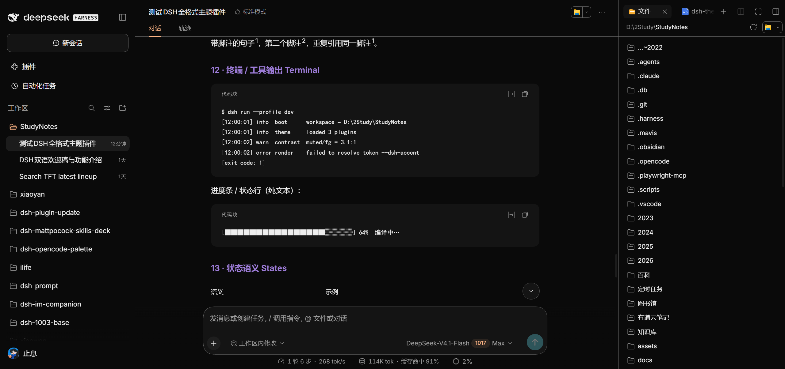
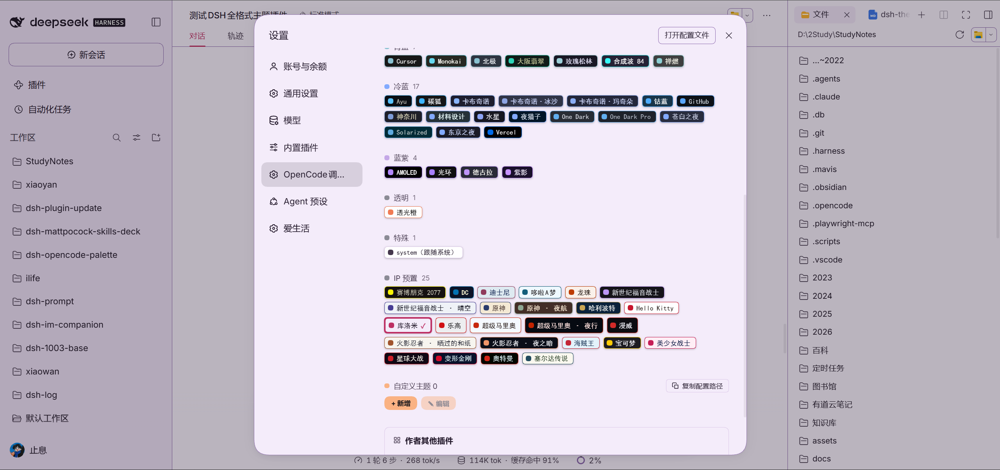
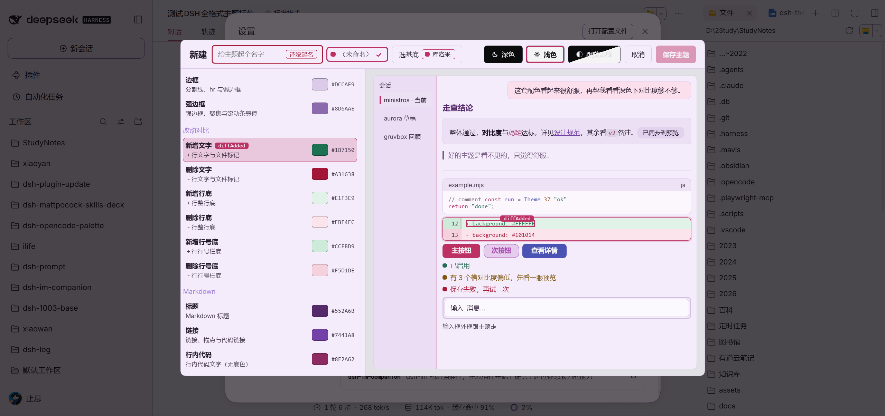
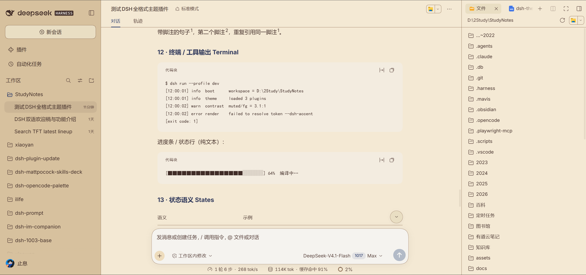
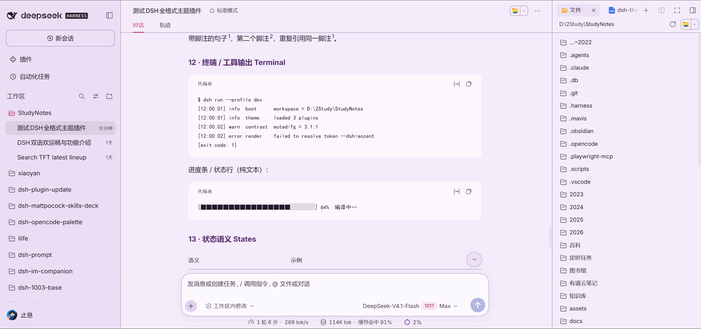
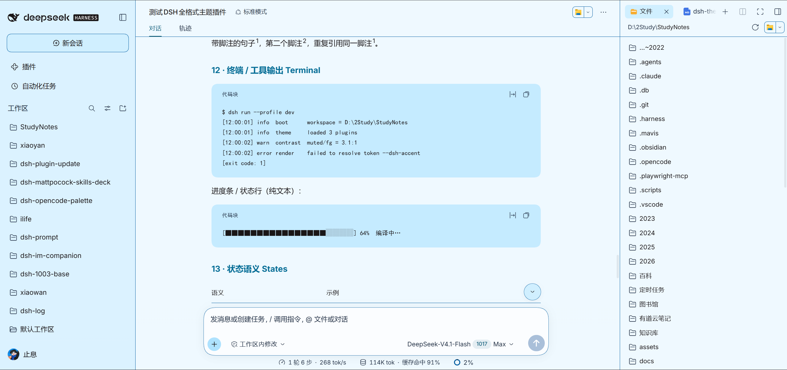
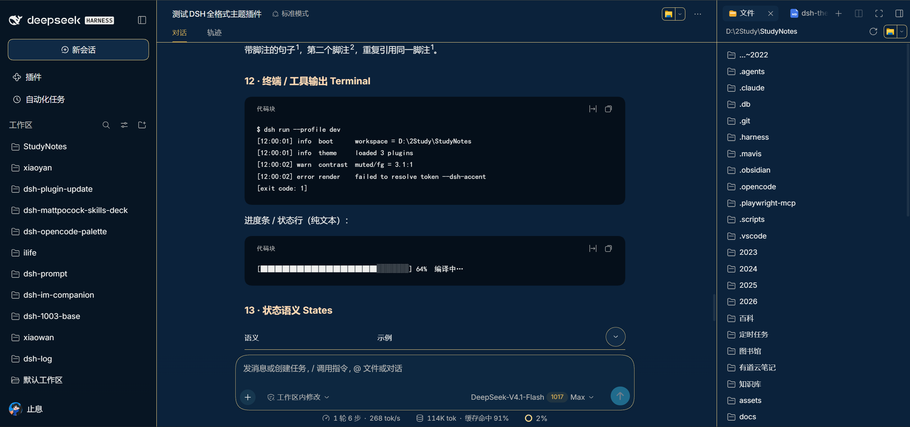
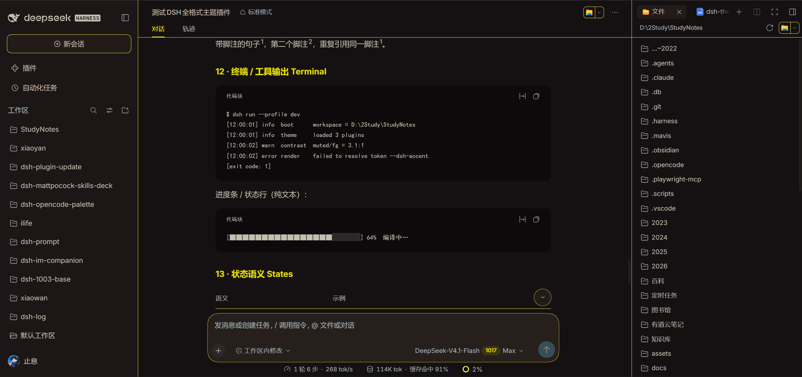
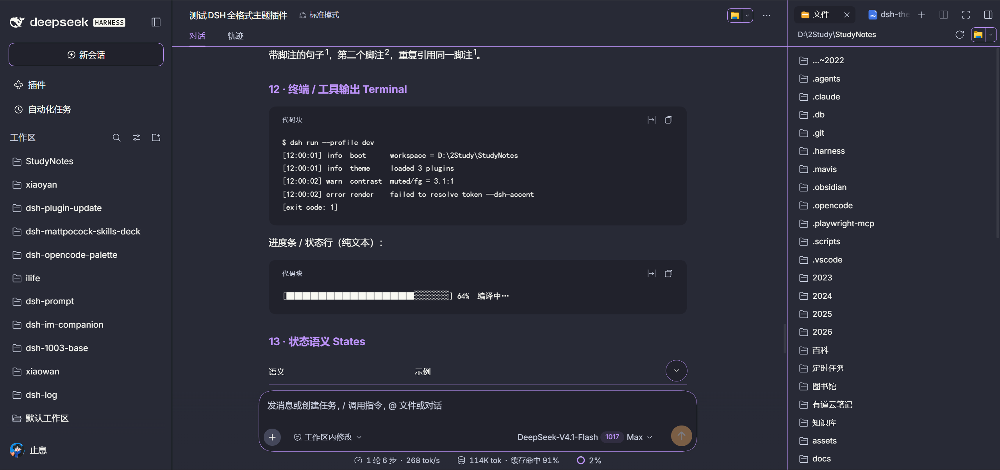
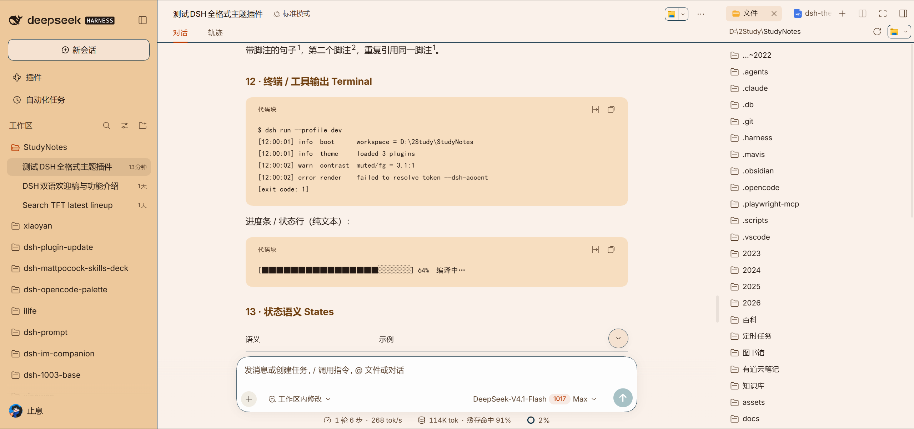

<h1 align="center">🎨 dsh-opencode-palette</h1>

<div align="center">

**🌐 [中文](README.md) · [English](docs/README.en.md)**

**38 款配色，一键给 DSH 换装。**

*38 themes for DSH, one click.*

你的 ⭐ 是我夜空中最亮的星。

[](https://www.npmjs.com/package/dsh-opencode-palette)
[](https://www.npmjs.com/package/dsh-opencode-palette)
[](https://github.com/FeatherHunter/dsh-opencode-palette/commits/main)
[](https://github.com/anomalyco/opencode)
[](https://github.com/FeatherHunter/dsh-opencode-palette/issues)

</div>

<!-- showcase:start -->
<h2 align="center"><sub>SHOWCASE</sub><br>真实效果</h2>

<div align="center">

---

本插件为您有更好的DSH体验而生💗

| 主界面（opencode 主题） | 设置面板（38 款按色系分组） |
|---|---|
|  |  |

| 自定义编辑器（37 个颜色） | IP 主题胶囊：原神（浅色） |
|---|---|
|  |  |

| IP 主题胶囊：库洛米（浅色） | IP 主题胶囊：哆啦A梦（浅色） |
|---|---|
|  |  |

| IP 主题胶囊：哈利波特（深色） | IP 主题胶囊：赛博朋克2077（深色） |
|---|---|
|  |  |

| 经典主题：德古拉（深色） | IP 主题胶囊：龙珠（浅色） |
|---|---|
|  |  |

</div>

<!-- showcase:end -->

<h2 align="center"><sub>INSTALL</sub><br>三步上手</h2>

```bash
# ① 还没装 DSH CLI 先装（已装跳过）
npm install -g @deepseek-ai/dsh

# ② 把插件装进你的 profile
dsh plugin --profile web add dsh-opencode-palette

# ③ 装完重启 DSH（或刷新浏览器页面）
```

**① 装好插件。**

**② 打开「OpenCode调色板」。** 设置 → 插件 → OpenCode调色板

**③ 挑一个喜欢的主题。**

<h2 align="center"><sub>EXTENSIONS</sub><br>OpenCode 主题之外提供的功能</h2>

| 能力 | 说明 |
|---|---|
| **IP 主题胶囊** | 预置 25 套：原神、库洛米、哆啦A梦、哈利波特、赛博朋克2077、宝可梦、龙珠……开箱即用，挑一套喜欢的当配色基底直接用。 |
| **打造专属胶囊** | 37 个颜色逐个调，右边是微缩的 DSH 预览：点预览里的元素，左边对应那行会滚到中间并打开取色器；鼠标划过左边的颜色，右边预览里那个元素会亮起一圈。存好的胶囊落在 `<DSH_HOME>/opencode-palette/custom-themes/`。 |
| **字体与字号** | 字体独立于颜色：等宽（终端风）把整个界面换成等宽字，常规（界面风）只让代码块用等宽；字号 11–24 px，代码字体可以直接从本机已装字体里挑。 |

<h2 align="center"><sub>UPGRADE</sub><br>升级</h2>

```bash
# 升级到最新版（当前 2.1.10）：web 与 desktop 两个 profile 各跑一条
dsh plugin --profile web update dsh-opencode-palette
dsh plugin --profile desktop update dsh-opencode-palette
# 需要钉回指定版本（把版本号换成你要的）：
dsh plugin --profile web add dsh-opencode-palette@2.1.10
dsh plugin --profile desktop add dsh-opencode-palette@2.1.10
```

「设置 → 插件 → OpenCode调色板」 → **检查更新**

<h2 align="center"><sub>MORE</sub><br>作者的其他作品</h2>

<div align="left">

喜欢这个插件的话，这几个你可能也用得上：

**[dsh-prompt](https://github.com/FeatherHunter/dsh-prompt)** —— 经常反复重复的模板化提示词，存成自定义模板，选中后直接注入，不再需要耗费精力。

**[dsh-mattpocock-skills-deck](https://github.com/FeatherHunter/dsh-mattpocock-skills-deck)** —— 近 30 万 star 的 mattpocock/skills 整套预置好（27 个技能），装好即用。

**[dsh-im-companion](https://github.com/FeatherHunter/dsh-im-companion)** —— 给 dsh-im 加了「助理」和「家」的概念。

**[ilife](https://github.com/FeatherHunter/ilife)** —— 爱生活：居家生活套件，记账、运动、饮食、体重、食谱、物品管理、作息规划、备忘录等。⚠️建设中⚠️待正式发布

</div>

<h2 align="center"><sub>THANKS</sub><br>感谢贡献者</h2>

<div align="left">

[@oopsdoes](https://github.com/oopsdoes) — #46 提议不透明主题也跟随浅色宿主（#45 搁置的另一半）🌹、#55 揪出跟随系统写成深色 🌹

[@gitwch1](https://github.com/gitwch1) — #73 在全新安装上复现不出，提出漏重启 DSH 或被别的主题插件双重覆盖 🌹

[@anci3ntr0ck](https://github.com/anci3ntr0ck) — #73 报大部分主题 diff 行看不清：增删底色压着文字，北极整条同色 🌹

[@SRKBob](https://github.com/SRKBob) — #43 嫌白色刺眼，想要一份不扎眼的配色 🌹

[@anupamme](https://github.com/anupamme) — #32 指出主题下载缺一道校验 🌹

[@Number444](https://github.com/Number444) — #12 要 Maple Mono NF CN 中英同宽 🌹

[@xiSage](https://github.com/xiSage) — #11 要任意系统字体，点开即列本机字体 🌹

[@the-beating-light-of-the-nail](https://github.com/the-beating-light-of-the-nail) — #3 收录进 DSH Meme Hub 换皮肤专区，附取色考据 🌹

</div>

<h2 align="center"><sub>CONNECT</sub><br>反馈与联系</h2>

<div align="center">

👏欢迎提交[PR](https://github.com/FeatherHunter/dsh-opencode-palette/pulls)、[ISSUE](https://github.com/FeatherHunter/dsh-opencode-palette/issues)。星星之火可以燎原🔥。有任何建议、意见、想法、吐槽、idea都可以进群交流。


</div>

<div align="center">


</div>
