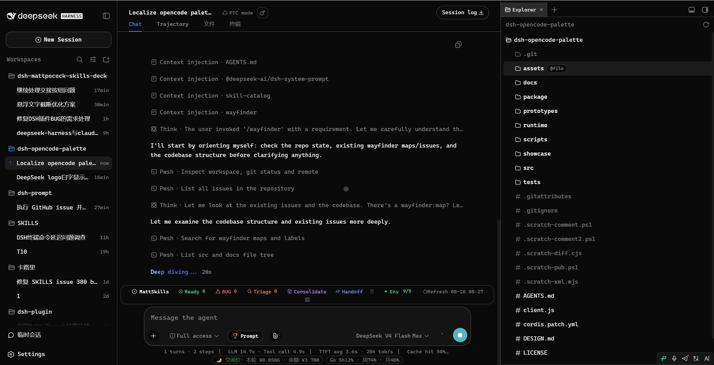
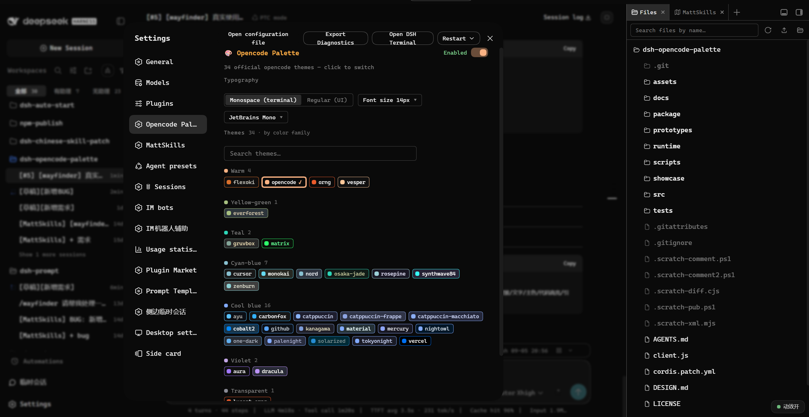
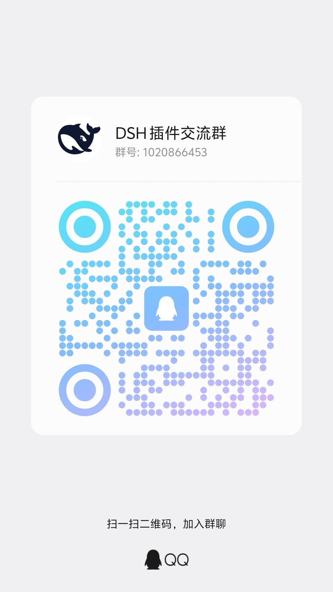

<h1 align="center">🎨 dsh-opencode-palette</h1>

<div align="center">

**🌐 [中文](../README.md) · [English](README.en.md)**

**38 themes for DSH, one click.**

*38 款配色，一键给 DSH 换装。*

Your ⭐ is the brightest star in my night sky.

[](https://www.npmjs.com/package/dsh-opencode-palette)
[](https://www.npmjs.com/package/dsh-opencode-palette)
[](https://github.com/FeatherHunter/dsh-opencode-palette/commits/main)
[](https://github.com/anomalyco/opencode)
[](https://github.com/FeatherHunter/dsh-opencode-palette/issues)

</div>

<!-- showcase:start -->
<h2 align="center"><sub>SHOWCASE</sub><br>Real Look</h2>

<div align="center">

---

This plugin exists to make your DSH experience better 💗

| Main screen (opencode theme) | Settings panel (38 themes by color family) |
|---|---|
|  |  |

| Custom editor (37 slots) | IP theme capsule: 原神 Genshin (light) |
|---|---|
|  |  |

| IP theme capsule: 库洛米 Kuromi (light) | IP theme capsule: 哆啦A梦 Doraemon (light) |
|---|---|
|  |  |

| IP theme capsule: 哈利波特 Harry Potter (dark) | IP theme capsule: 赛博朋克2077 Cyberpunk 2077 (dark) |
|---|---|
|  |  |

| Classic theme: 德古拉 Dracula (dark) | IP theme capsule: 龙珠 Dragon Ball (light) |
|---|---|
|  |  |

</div>

<!-- showcase:end -->

<h2 align="center"><sub>INSTALL</sub><br>Get started in three steps</h2>

```bash
# 1. install the DSH CLI first (skip if you have it)
npm install -g @deepseek-ai/dsh

# 2. add the plugin to your profile
dsh plugin --profile web add dsh-opencode-palette

# 3. restart DSH once it's installed (or refresh the browser page)
```

**① Install the plugin.**

**② Open “OpenCode Palette”.** Settings → Plugins → OpenCode Palette

**③ Pick a theme you like.**

<h2 align="center"><sub>EXTENSIONS</sub><br>What the OpenCode themes come with</h2>

| Feature | Details |
|---|---|
| **IP theme capsules** | 25 preinstalled: 原神 Genshin, 库洛米 Kuromi, 哆啦A梦 Doraemon, 哈利波特 Harry Potter, 赛博朋克2077 Cyberpunk 2077, 宝可梦 Pokémon, 龙珠 Dragon Ball… ready out of the box — pick one you like and use it as the base for your colors. |
| **Build your own capsule** | 37 slots, one at a time, with a miniature DSH preview on the right — click an element in the preview and the matching row on the left scrolls to the middle and opens the color picker; hover a slot on the left and that element lights up in the preview. Saved capsules land in `<DSH_HOME>/opencode-palette/custom-themes/`. |
| **Fonts and size** | Fonts sit apart from color: Mono (terminal look) turns the whole interface monospaced, Regular (interface look) applies monospace to code blocks only; size 11–24 px, and the code font can be picked from the fonts installed on this machine. |

<h2 align="center"><sub>UPGRADE</sub><br>Upgrade</h2>

```bash
# upgrade to the latest (currently 2.1.10): one command per profile — web and desktop
dsh plugin --profile web update dsh-opencode-palette
dsh plugin --profile desktop update dsh-opencode-palette
# pin a specific version (swap the version number for the one you want):
dsh plugin --profile web add dsh-opencode-palette@2.1.10
dsh plugin --profile desktop add dsh-opencode-palette@2.1.10
```

Settings → Plugins → OpenCode Palette → **Check for updates**

<h2 align="center"><sub>MORE</sub><br>More from the author</h2>

<div align="left">

If you like this plugin, these might be useful too:

**[dsh-prompt](https://github.com/FeatherHunter/dsh-prompt)** — The boilerplate prompts you repeat over and over, saved as custom templates and injected in one click — no more effort spent.

**[dsh-mattpocock-skills-deck](https://github.com/FeatherHunter/dsh-mattpocock-skills-deck)** — The whole mattpocock/skills set (nearly 300k stars) preinstalled — 27 skills, ready as soon as it's installed.

**[dsh-im-companion](https://github.com/FeatherHunter/dsh-im-companion)** — Adds the ideas of an “assistant” and a “home” to dsh-im.

**[ilife](https://github.com/FeatherHunter/ilife)** — iLife (爱生活), the home-life suite: bookkeeping, exercise, diet, weight, recipes, item management, schedule planning, memos and more. ⚠️Work in progress⚠️pending official release

</div>

<h2 align="center"><sub>THANKS</sub><br>Contributors</h2>

<div align="left">

Thanks to everyone who opened an issue, sent a PR, or joined a discussion — you made this plugin better bit by bit.

<!-- THANKS-TABLE-EN-START -->
| Contributor | Tribute | Contributions |
| --- | --- | --- |
| [@oopsdoes](https://github.com/oopsdoes) | 🌹🌹 | [#46](https://github.com/FeatherHunter/dsh-opencode-palette/issues/46) [#55](https://github.com/FeatherHunter/dsh-opencode-palette/issues/55) |
| [@insp63](https://github.com/insp63) | 🌹 | [#124](https://github.com/FeatherHunter/dsh-opencode-palette/issues/124) |
| [@gitwch1](https://github.com/gitwch1) | 🌹 | [#73](https://github.com/FeatherHunter/dsh-opencode-palette/issues/73) |
| [@anci3ntr0ck](https://github.com/anci3ntr0ck) | 🌹 | [#73](https://github.com/FeatherHunter/dsh-opencode-palette/issues/73) |
| [@SRKBob](https://github.com/SRKBob) | 🌹 | [#43](https://github.com/FeatherHunter/dsh-opencode-palette/issues/43) |
| [@anupamme](https://github.com/anupamme) | 🌹 | [#32](https://github.com/FeatherHunter/dsh-opencode-palette/pull/32) |
| [@Number444](https://github.com/Number444) | 🌹 | [#12](https://github.com/FeatherHunter/dsh-opencode-palette/issues/12) |
| [@xiSage](https://github.com/xiSage) | 🌹 | [#11](https://github.com/FeatherHunter/dsh-opencode-palette/issues/11) |
| [@the-beating-light-of-the-nail](https://github.com/the-beating-light-of-the-nail) | 🌹 | [#3](https://github.com/FeatherHunter/dsh-opencode-palette/issues/3) |
<!-- THANKS-TABLE-EN-END -->

And thanks to everyone who left thoughts in comments and discussions. If you hit a problem or have an idea, feel free to open an issue or start a discussion.

</div>

<h2 align="center"><sub>CONNECT</sub><br>Feedback and Contact</h2>

<div align="center">

👏Welcome PRs and issues. A single spark can start a prairie fire 🔥. Any suggestion, opinion, idea or rant — come join the group and talk.

<table align="center"><tr><td align="center"><b>QQ Group</b></td><td align="center"><b>WeChat Group</b></td><td align="center"><b>Feishu Group</b></td></tr><tr><td></td><td></td><td></td></tr></table>

</div>

<div align="center">


</div>

